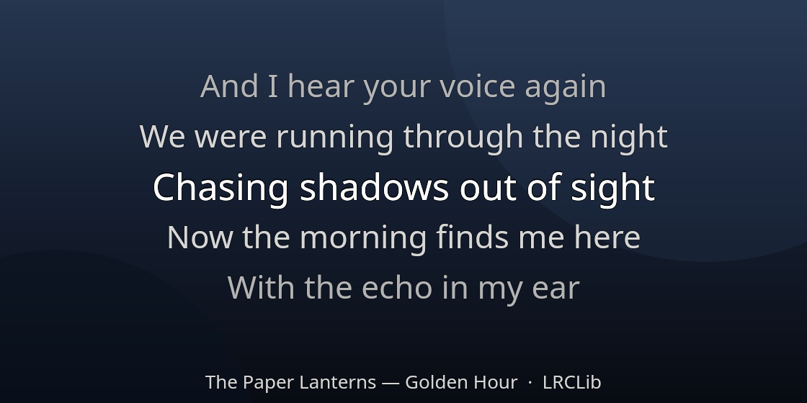

<div align="center">

# Pear Lyrics

[](https://kde.org/plasma-desktop/)
[](LICENSE)

Synced lyrics widget for KDE Plasma, following the song playing in [Pear Desktop](https://github.com/pear-devs/pear-desktop) or any other MPRIS-compatible player.



</div>

## Features

- Time-synced, karaoke-style lyrics with the current line highlighted.
- Optional “current line only” mode with fade or fade-and-slide animations.
- Adjustable font size, context lines, timing offset and track info.
- Multiple lyric providers with automatic fallback.
- Supports plain, unsynchronised lyrics as a last resort.
- Shows which provider supplied the lyrics.

## Lyrics sources

| Source | Synced | Notes |
| --- | --- | --- |
| **LRCLib** | Yes | Default source. Free, open and does not require an API key. |
| **YouTube Music** | Yes | Uses YouTube Music's InnerTube endpoints. Timed lyrics are available for most tracks. |
| **Genius** | No | Plain lyrics scraped from Genius. Used when no synced lyrics can be found. |

The widget tries the selected source first, then the other two. If a provider only returns plain lyrics, it keeps looking for a synced version and falls back to the plain result only when no provider has timed lyrics.

## Requirements

- KDE Plasma 6
- `playerctl`
- A player exposing MPRIS metadata, such as Pear Desktop

Install `playerctl` with your distribution's package manager:

```sh
# Arch Linux
sudo pacman -S playerctl

# Fedora
sudo dnf install playerctl

# Kubuntu / Debian
sudo apt install playerctl

# openSUSE
sudo zypper install playerctl
```

## Installation

### From source

```sh
git clone https://github.com/Ayushrestha05/pear-lyrics.git
cd pear-lyrics
./install.sh
```

The script installs the widget for the current user and upgrades it if it is already installed.

### Manual installation

Install the package directory directly:

```sh
kpackagetool6 --type Plasma/Applet --install package
```

To update an existing installation:

```sh
kpackagetool6 --type Plasma/Applet --upgrade package
```

Restart Plasma or re-add the widget after installing:

```sh
systemctl --user restart plasma-plasmashell
```

## Usage

1. Add the **Pear Lyrics** widget to your desktop or panel.
2. Start playback in Pear Desktop or another MPRIS player.
3. Lyrics are fetched automatically when the track changes.

### Configuration

Right-click the widget and choose **Configure Pear Lyrics…**, or open the widget settings from Plasma.

- **Lyrics → Default source** — choose LRCLib, YouTube Music or Genius.
- **Display** — toggle current-line-only mode, context lines, track info and font size.
- **Animation** — enable line transitions and choose the animation style and duration.
- **Player** — set a timing offset or restrict the widget to a specific `playerctl` player.

The currently used provider is displayed next to the artist and title when **Show artist and title** is enabled.

## How lyrics are selected

1. The selected default source is queried first.
2. If it has no lyrics, the remaining sources are tried in order.
3. Synced lyrics always win over plain lyrics.
4. Plain lyrics are displayed as a scrollable lyrics sheet when nothing synced is available.
5. If every provider fails, the widget shows **No lyrics found**.

Source order examples:

- LRCLib selected: LRCLib → YouTube Music → Genius
- YouTube Music selected: YouTube Music → LRCLib → Genius
- Genius selected: Genius → LRCLib → YouTube Music

## Troubleshooting

### “No player found”

Make sure `playerctl` is installed and that a player is running:

```sh
playerctl -l
playerctl metadata --format '{{status}} :: {{artist}} :: {{title}}'
```

If you have multiple players, set the player name in the widget configuration.

### No lyrics found

The track may not be available in any of the providers. Instrumentals and very new or obscure releases are common causes.

### Lyrics are out of sync

Use the timing offset in the widget settings. Positive values show lyrics earlier; negative values show them later.

### YouTube Music or Genius stopped working

Both providers use unofficial endpoints and may change without notice. The widget automatically moves on to the next source. LRCLib is the most stable option.

## Publishing to the KDE Store

Build the store package:

```sh
./package.sh
```

This creates `dist/org.user.pearlyrics-<version>.plasmoid`.

To publish it:

1. Sign in to <https://store.kde.org/>.
2. Choose **Add Product** and select **Plasma 6 Add-Ons → Plasma Applets**.
3. Fill in the product page:
   - **Name:** Pear Lyrics
   - **Description:** synced lyrics for Pear Desktop and other MPRIS players
   - **License:** GPL-2.0+
   - **Source code:** <https://github.com/Ayushrestha05/pear-lyrics>
   - **Bug reports:** <https://github.com/Ayushrestha05/pear-lyrics/issues>
   - **Screenshot:** `screenshots/screenshot.png`
4. Upload `dist/org.user.pearlyrics-<version>.plasmoid` as the download file.
5. Publish the product.

Once indexed, users can install it from Plasma with **Add Widgets → Get New Widgets → Download New Plasma Widgets** and searching for **Pear Lyrics**.

For updates, bump `Version` in `package/metadata.json`, run `./package.sh`, and upload the new `.plasmoid` to the same store product.

A GitHub Release is also useful as a direct download and as a fallback link from the store page:

```sh
gh release create v1.1 dist/org.user.pearlyrics-1.1.plasmoid \
  --title "Pear Lyrics 1.1" \
  --notes "Synced lyrics with LRCLib, YouTube Music and Genius fallback."
```

## Repository layout

```text
.
├── package/
│   ├── metadata.json
│   └── contents/
│       ├── config/
│       │   ├── config.qml
│       │   └── main.xml
│       └── ui/
│           ├── configGeneral.qml
│           └── main.qml
├── screenshots/
│   └── screenshot.png
├── install.sh
├── package.sh
├── LICENSE
└── README.md
```

- `package/contents/ui/main.qml` — widget UI, player polling and lyric fetching.
- `package/contents/ui/configGeneral.qml` — configuration page.
- `package/contents/config/main.xml` — configuration schema and defaults.
- `package.sh` — builds the installable `.plasmoid` in `dist/`.

## Credits

- [LRCLib](https://lrclib.net/) for the open lyrics database.
- [YouTube Music](https://music.youtube.com/) for timed lyrics.
- [Genius](https://genius.com/) for additional lyrics.
- [playerctl](https://github.com/altdesktop/playerctl) for MPRIS control.
- [Pear Desktop](https://github.com/pear-devs/pear-desktop) for the original use case.

## License

This project is licensed under the [GNU General Public License v2.0 or later](LICENSE).
